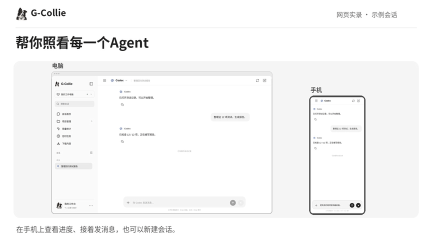

# G-Collie · Agent 会话控制台

**帮你照看每一个Agent**

在手机或浏览器上查看电脑里正在执行的 Agent 会话、接着发消息，也可以选助手和项目，新建会话。任务始终在自己的电脑上执行。支持 Codex、Hermes 和 Claude Code，具体操作取决于会话来源。

[官网自动演示](https://gigglerobotics.github.io/G-Collie/#demo) · [下载 Linux amd64 电脑端（DEB 0.3.35）](https://github.com/GiggleRobotics/G-Collie/releases/download/v0.3.35/g-collie_0.3.35_amd64.deb) · [下载 Android arm64 手机端（APK 0.1.51）](https://github.com/GiggleRobotics/G-Collie/releases/download/v0.3.35/g-collie-0.1.51-android-arm64-release.apk)

<picture>
  <source media="(prefers-reduced-motion: reduce)" srcset="docs/使用示例/g-collie-cover.jpg">
  
</picture>

## 安装与首次连接

在已登录助手的 Linux 电脑上安装 DEB 并运行 `g-collie`，在 Android 手机上安装 App。让两端加入同一私网，再用电脑给出的地址和一次性配对码连接。[首次连接图文与视频](https://gigglerobotics.github.io/G-Collie/start/)

其他架构、SHA256 校验文件和旧内测用户的同签名升级包见 [v0.3.35 发行页](https://github.com/GiggleRobotics/G-Collie/releases/tag/v0.3.35)。

## 继续已有会话

打开「最近会话」或按项目查找，查看消息、工具调用和附件。Codex、Hermes 可以在本机接口支持时继续原会话。Claude Code 的外部终端历史可查看，通过 G-Collie 创建的会话可继续发送或停止。[三种助手的操作范围](docs/能力矩阵.md)

## 文档与开发

[电脑端手册](docs/电脑端使用说明.md) · [手机端手册](docs/手机端使用说明.md) · [远程连接与排错](docs/内置远程连接.md)

- 查安装、备份与升级，可读[用户手册](docs/README.md)和[发行说明](RELEASE.md)。
- 从源码验证和构建可查[测试说明](TESTING.md)和[Android 构建指南](flutter_client/README.md)。
- 遇到问题，请附上版本、助手类型和复现步骤。[提交问题](https://github.com/GiggleRobotics/G-Collie/issues)

项目自有代码按 GNU GPL v3（仅第 3 版）分发。模型请求和私网连接遵循你所用服务的数据政策，反馈问题前请移除凭证和私人会话。[许可证](LICENSE) · [项目声明](NOTICE) · [第三方许可](THIRD_PARTY_NOTICES.md)
