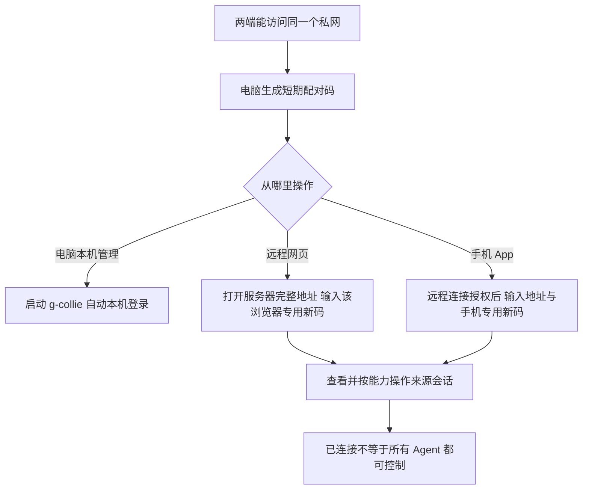

# G-Collie 内置远程连接

适用版本：电脑服务 **0.3.32**、Android **0.1.47（49）**。更新日期：2026 年 11 月 17 日。

## 连接前要知道

电脑和手机各自内置一个 Tailscale 网络节点，两端安装 G-Collie 后分别授权入网即可，**无需另装官方 Tailscale、配置 Serve 或开放公网端口**。手机模块只为 G-Collie 建立连接，不接管其他 App 流量，不要求配置 Android VPN。

电脑与手机必须加入同一个有访问权限的私有网络，管理员设备审批和访问策略继续生效。然后还须完成 G-Collie 自己的设备配对：入网解决“能连接地址”，配对解决“允许此设备访问会话”。当前新配对固定为控制设备，实际操作能力仍取决于电脑 Agent，不提供配对时选择只读权限的流程。

任务始终在电脑运行，电脑必须保持唤醒、联网并运行服务。不要公开网络授权链接、配对码、完整配对链接或应用私有数据。

### 当前冷启动验证与诊断

本轮正式手机及两台服务器已完成相关验证，当前 VPN 环境冷启动恢复；具体范围与未测边界见 [验证记录](开发/06-版本发布记录.md)。

安全诊断只保存固定阶段／错误类别的有界计数及网络类别、DNS／地址族数量，不保存原始日志、地址或凭证；普通 Status／Open 不无条件刷新网络，不清除身份或配对。排错提供版本、等待时长与脱敏分类，不需要退出网络、清数据或重新配对。

## 1. 电脑授权入网

1. 安装包含网络模块的电脑 DEB，运行 `g-collie` 打开管理页面。
2. 侧边栏 **服务端管理 → 网络与服务**，找到 **内置远程连接**。
3. 点击 **启动内置网络**，再点 **生成登录入口**。
4. 点击 **在浏览器登录 Tailscale**，完成电脑登录与设备授权。需要管理员批准时等待批准。
5. 回管理页，等待 **已加入私有网络**，复制 **手机连接地址**。

地址通常形如 `http://100.x.x.x:4310`，请复制自己的完整地址，保留 `http://` 和 `:4310`。该 HTTP 连接经过私有加密隧道，未因此向公网开放服务。

启动后服务重启会尝试恢复内置连接。**停止内置连接** 会关闭此网络入口并停用自动恢复，不会停止 Agent 任务；**退出网络账号** 后需重新授权。不要在依赖该入口的真实任务期间随意停止网络。

## 2. 手机授权入网

1. 安装当前 APK，打开首次连接页，点击顶部 **⋮ → 远程连接**。已进入会话时也使用顶部同名入口。
2. 点击 **登录 / 授权入网**，在 App 内官方授权窗口登录，并授权手机节点。
3. 返回 App，等显示 **已加入私有网络，可以连接电脑**。若显示等待管理员批准，先完成网络批准。
4. 返回连接页面。可点击远程连接中发现的电脑自动填地址，也可手填电脑给出的完整地址，下一步再填六位配对码。

手机和电脑是两个独立网络节点，电脑已授权不表示手机也已授权。手机内置网络只供本 App 使用，因此系统浏览器打不开内置地址，不一定表示 APK 连接失败。

## 3. 设备配对

1. 电脑管理页侧边栏 **服务端管理 → 手机配对与设备**，在 **手机访问地址** 中选刚才的内置网络地址。
2. 点击 **生成配对二维码**。
3. 手机填写电脑地址与六位配对码，点击 **配对并连接**；首次／添加电脑表单使用“地址＋六位码”；配对网页上的 **在 G-Collie APK 中打开** 可自动处理完整链接。
4. 进入会话首页后，读取会话列表和消息，再从 **⋮ → 远程连接 → 测试连接** 检查当前链路。

配对码十分钟有效、一次使用，新码替换旧码，连续五次输错需重新生成。凭证九十天有效，被撤销或解除配对后需重配。

APK 和浏览器的配对独立。相机扫码可能配对了浏览器；在 APK 使用时应手填地址与六位码，或点击网页 **在 G-Collie APK 中打开**。已被浏览器使用的码不能再给 APK 使用。电脑界面个别提示仍写“手机与配对”或“电脑与连接”，当前网页集中入口是侧边栏 **服务端管理**。

**不要把手机地址填成 `127.0.0.1`、`localhost` 或 ADB 调试端口。** 电脑服务地址必须包含正确协议和服务端口；不要凭发现了电脑、已有同一网络或打开了任意网页就判断连接通过。

### 无图形桌面的服务器与远程网页

服务已经启动、且从自己的网络能访问服务器时，在服务器 SSH 终端用运行 G-Collie 的同一用户执行：

```bash
g-collie pair
# 需要明确指定本服务器访问地址时：
g-collie pair http://服务器自己的私网IP:4310
```

输出包含六位配对码、短期链接与到期时间。用新码配对远程网页，再为手机另生成一个新码；不需要先在服务器图形浏览器登录。管理密钥仅供本机管理，不发到远程网页或手机。无头安装、旧版本替代流程见 [电脑端使用说明](电脑端使用说明.md#服务器部署与限制)。



### 断线与恢复

电脑离线、手机切网或服务重启时，先等连接恢复，必要时从 **电脑与连接／远程连接** 重新检测。**已加入私网** 只说明节点状态，不证明目标电脑可达。切换电脑失败时界面可能仍保留旧电脑；先核对顶部当前电脑，再到 **切换电脑 → 连接状态** 核对地址，返回后重新测试该目标。旧电脑的测试结果不能证明新电脑可达。可见缓存历史不表示当前任务已停止，断线也不表示请求未执行。发送、批准、停止、删除出现 **结果未知** 时，先刷新核对来源记录，禁止用反复提交来“试通”。恢复后确认电脑名称、实际地址、会话状态，再继续操作；普通重连不需要清数据或重建网络身份。

## 4. 日常使用与多台电脑

顶部 **⋮ → 切换电脑** 或工作台 **电脑与连接** 打开电脑列表，点击已配对电脑切换；**添加电脑** 为另一台电脑录入完整地址及六位配对码，每台电脑独立保存凭证。取消添加返回列表，不强制重新连接原电脑。

手机会保存网络身份和各电脑配对。正常同签更新 APK 可保留数据；换签不支持直接覆盖，先阅读 [签名迁移](../RELEASE.md#android-签名与升级)。卸载或清除数据会丢失本地信息，不会删除电脑会话。解除当前电脑配对不会停止电脑任务。

网络通了、配对成功后仍可能只读，例如电脑未启动 Codex 桌面 App、桌面接口不可用、控制未启用、会话已归档或实时会话未加载。应检查后端，不要通过反复配对解决。只读历史和实际消息控制应分别验证。

## 5. 任务提醒边界

APK 顶部 **⋮ → 任务提醒 → 开启提醒**，允许系统通知后显示后台同步常驻通知，可提醒任务结束、需要处理和断线；通知不含聊天正文。相同菜单或常驻通知可停止提醒。

最近打开的最多三十个会话会被关注，服务重启后恢复列表；首次载入、服务重启与断线期间不会推断任务完成。系统省电、强制停止、网络变化和 Android 后台同步时长限制可能中断提醒，达到限制后需打开 App 重新开启。不承诺长期锁屏或全天候在线。

内置 HTTP 地址不满足浏览器 Web Push 的 HTTPS 要求。若另用浏览器/PWA，需准备该浏览器可访问的 HTTPS 入口，独立配对、授权并测试；APK 的网络和通知权限不会自动传给浏览器。

## 6. 常见问题

| 状态或问题 | 处理 |
| --- | --- |
| 未启动 | 电脑点击启动内置网络；手机打开远程连接查看状态 |
| 需要登录 | 点击对应端登录入口，分别完成官方授权 |
| 等待网络管理员批准 | 请管理员批准新节点，检查访问策略 |
| 安装包未包含网络模块 | 核对是否安装当前完整 DEB/APK，而非旧包或不完整构建 |
| 已入网但电脑打不开 | 核对服务地址端口、电脑是否运行与唤醒、电脑网络入口和访问策略 |
| 地址响应其他服务 | 使用了错误端口，复制电脑展示的完整 G-Collie 地址 |
| 测试连接成功但另一台电脑仍连不上 | 测试针对发起时的当前电脑连接；先核对顶部主机及连接状态地址，确认切换成功后重测。不要用旧机结果判断新机，也不要先清数据或退出网络重配 |
| 配对码无效 | 检查有效期、是否已被浏览器使用，重新生成后在 APK 使用 |
| 浏览器不能打开内置地址 | 手机模块只供 G-Collie；在 APK 中测试该连接 |
| 同一 Wi-Fi 仍连不上 | 默认服务只监听本机，局域网访问需明确配置；推荐使用内置入口 |
| 不能发送消息 | 检查 Agent 和会话状态，网络与配对不能替代实时控制接口 |
| 分享链接打不开 | 接收者也需能访问电脑私有网络，分享不会开放公网权限 |

已有系统 Tailscale/Serve 的用户可在电脑 **服务端管理 → 网络与服务 → 兼容已有的系统 Tailscale 连接** 查看原入口，按实际完整 HTTPS 地址连接。内置连接和系统节点不同，不要为了本应用随意退出系统节点或改动其他服务。

本指南描述当前实现，不代表所有账号、跨网和长后台场景均通过实机验收。版本及设备证据见 [当前工作](开发/01-当前工作.md)；完整手机操作见 [手机端使用说明](手机端使用说明.md)。
