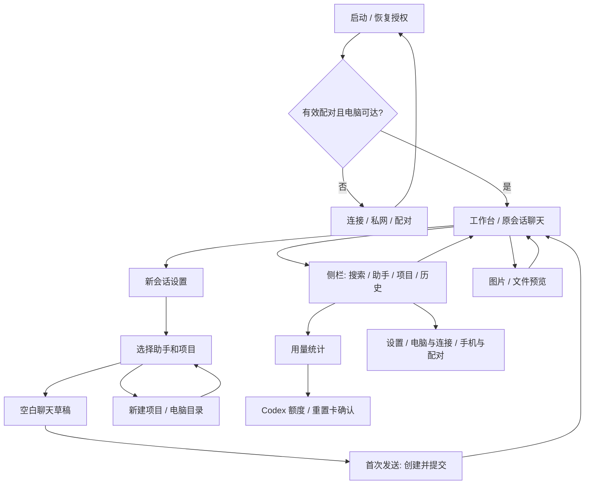

## 2026-11-21 · 首条消息的发送状态（已确认并同步实现）

用户确认了双端原型。正式网页与手机的源码已将首发状态放在输入框上方，同屏显示本次正文和附件。等待期间隐藏「发送第一条消息开始」等草稿引导。以下状态见于新会话首发。

| 电脑端状态 | 草稿中的反馈与操作 |
| --- | --- |
| 首条正在提交 | 显示「正在发送首条消息」，暂时锁定输入和发送。 |
| 回执未到 | 显示「正在确认发送结果」，保留正文和附件。查询回执不会再次发送消息。 |
| 确认未提交 | 显示「首条消息未发送」及本次原因。服务端指出某张图片无法读取时，可改正文，移除或更换该图后可手动发送。普通失败保留可编辑的草稿。 |
| 确认已发送 | 进入对应会话。首发提示随草稿结束。 |

在 [手机原型](交互原型/index.html?page=chat&detail=first-send-unknown) 或 [网页原型](交互原型/web.html?page=chat&detail=first-send-unknown) 的细节选择器中可切换三种状态。原型使用演示数据。正式实现已用生产网页构建及 Flutter 组件独立验证。现有会话沿用 P02 的重试规则，分环境验证见[本轮记录](06-版本发布记录.md)。

窄屏网页在辅助页标题左侧使用现有会话列表按钮。点开侧栏可回会话首页，也可直接选历史会话。覆盖项目、用量、定时、下载、诊断及服务端管理。宽屏继续显示常驻侧栏。正式网页已验证可用键盘打开侧栏、Esc 关闭并返回触发按钮。可在 [390px 项目管理原型](交互原型/web.html?page=projects&size=390) 试用。

## 2026-11-17 · Codex 已查看图片漏显（方向已确认，正式复验中）

原生ImageView被过程投影丢弃已定位；后台解析及安全tool.media授权修复通过测试，未部署。既有原型 `page=chat&detail=image-view`（含multiple/failure）展示工具查看图片与复用图库。用户已确认；后续明确要求默认折叠、点已查看标题展开/收起、图片与指令左对齐。正式Flutter已同步并测试，最终构建/真机尚在复验，不提前标通过。详见01与06本轮记录。

## 2026-11-17 当前正式流程（0.3.32／0.1.47）

当前已部署，本机连接 P0 经内置网络代理隔离修复后在当前手机网络恢复通过；长后台/切网仍未验。此前 0.3.31／0.1.46 真机记录仅代表历史时点，不能替代本轮证据；本轮保留原配对，不改界面与导航。验收须原凭据恢复、原历史可读、离线禁写且不重发失败/unknown消息，当前环境冷启补验，具体证据见01和06。

## 2026-11-17 · 0.3.32 终端 Codex 控制与会话来源修复

- 用户追加要求：Codex 纯终端控制作为整个服务能力，本机、JDCLOUD、SG 同步更新；不删除真实会话、改登录或另装隔离手机 App。
- 服务启动按 `ORBIT_CODEX_BACKEND=auto|desktop|app-server` 固定路由，有桌面 IPC 保留原桥，无桌面使用原生 app-server。现有安全 daemon 优先；独立 stdio 恢复历史前保守检查其他 Codex 进程占用，读取不隐式 resume。新建保留助手／项目→草稿首发流程。
- 原生控制适配首发、继续发送、执行中 steer、当前轮 interrupt、已提供的命令／文件审批、问答及图片／文件。审批／问答等同当前连接+会话+请求的 resolved 才成功；超时和断线为持久 unknown，不换编号重放。终端计划模式未验证，不展示也不接受；Codex／Claude 安全删除仍未适配。
- “未命名且内容重复”的列表问题为内部子 Agent 被误展示；只过滤明确 subagent 来源，列表先过滤后限量、详情同样拒绝，普通用户 fork／handoff 等保留，不删除底层记录。
- 真实 CLI 0.144.6（JDCLOUD）、0.157.0（本机）、0.168.0（SG）各用临时 CODEX_HOME、dummy 凭据和仅本地 Responses 模型完成 12 项 raw／bridge 测试；不等同真实账号模型额度或手机端完整验收。三机部署及 SG 现存 daemon 接入结果以 06 本轮最终记录为准。


已确认原型同步：网页首页文字新建/顶栏入口→助手与项目→空草稿→首发创建，不要求名称；手机保留原新建图标。双端菜单删除→核来源与范围→新鲜资格→二次确认；本地显式执行/等待/启动、离线/只读/忙/草稿禁删；历史unknown仍查服务端，服务端allowed才可提交，unknown结果不重发。手机系统选图返回临时loading保留附件，切会话/降权/离线仍拦；低高横屏侧栏仅增加整体滚动，正常高视觉顺序保留。正式手机已逐项操作及独立证据复核，参06。以下为历史时点。

## 2026-11-17 已确认并同步正式实现

用户已确认原型方向。正式网页首页文字新建、免名称草稿首发及双端删除已同步；删除仅Hermes新版原生安全能力，其他来源明确未适配，确认包含压缩/重置历史和分享提醒。JDCLOUD/SG电脑0.3.28已部署，手机0.1.42已构建未安装（ADB未连接），不同验证层结果见06。本条覆盖下方历史“待确认”状态。

## 2026-11-17 原型已可预览（未确认、未同步生产）

入口：既有web.html、index.html手机原型。网页首页“最近会话”旁增加带文字的新建，保留顶栏入口；新会话设置仅助手和项目，取消不创建，首次发送才创建标题。双端会话菜单删除需确认，标明电脑/助手/会话、移除历史不可恢复、不删项目文件；运行/等待/未知/离线/只读/不支持来源禁删，失败保留并可重试，结果未知不重放。当前操作仅演示数据，永久删除后端仍未实现。

截图：网页首页（本地验收证据，不随仓库发布）、免名称新建（本地验收证据，不随仓库发布）、网页删除（本地验收证据，不随仓库发布）、手机删除（本地验收证据，不随仓库发布）。依现行AGENTS先展示用户确认，再正式实现/构建/真机；用户“继续”不当作尚未展示原型的方向确认。

## 2026-11-16 新建与删除原型变更（待用户确认，未同步生产）

网页首页最近会话区新增文字+笔图标新建入口，保留顶栏入口；新建设置移除名称必填和先行首条输入，选助手/项目后进入草稿，首次发送创建，向手机现行流程对齐。网页和安卓既有原型增加会话菜单删除与二次确认、运行/等待/未知/离线/只读/不支持禁用、失败保留和结果未知提示。具体截图与可操作原型由本轮复验补充。生产网页/手机本轮尚未改动，不提前安装正式改版。

# 当前界面与流程

项目全称为「G-Collie · Agent 会话控制台」，用于仓库 README 标题、网页标签页标题和 Android 关于页。仓库名与手机桌面应用名使用短名「G-Collie」。

## 2026-11-15 已确认原型正式同步（当前优先）

用户确认轻量双栏并授权发版后，电脑0.3.25／手机0.1.39+41按原型同步：保留40+48双栏及原刷新入口，电脑图标／名称为轻量辅助信息，正常连接仅点、异常显示文字；正文顶8dp。关于恢复居中弹层，正文沿用网页两短段，统一“帮你照看每一个 Agent”；首页改“现在想继续哪项工作？”。工具／公开思考详情仍左侧归属，复制放入灰框首行右端，保留触控空间，正文不与图标重叠。撤回的单栏、独立左对齐关于页、卡外复制行不再是现行方案。

服务端管理→手机日志：修复继承 connection-card 横向 flex 的根因，使用纵向卡片；标题、说明、字段与按钮顺序清晰，字段自适应分列，窄宽自动堆叠。当前正式 dist 在1440／1264／1024／768／390px五宽通过无横溢出、标题独行、日期输入不少于230px检查。原型和浏览器不替代本轮手机实机，安装结果见06。


状态：现有 Flutter 界面的截图、流程与文字线框，供核对现状。历史截图不保证与 0.1.9 完全一致。

需要实际点击体验，请打开 [可交互原型](交互原型/index.html)，操作范围与验证记录见 [原型说明](交互原型/README.md)。原型现直接编译当前 App 的 Flutter 页面组件，仅替换数据与原生能力适配。页面源码一致性经过校验；与手机已安装包的逐页像素核对尚未完成。

## 当前页面 UI

下面直接展示仓库已有的 Flutter 页面截图，方便对照实际界面评审。截图来自历次验收，并非本次重新运行 App 获取；该批截图整理时客户端为 0.1.9，当前源码 Flutter 为 0.1.38+40；较早截图中的按钮、文案和布局可能已变化。新会话卡片已有 0.1.5 布局截图；最新用量页及重置卡状态尚缺 Flutter 截图。

### 连接与配对


### 内置网络


### 工作台首页


### 会话聊天


### 新会话：助手与项目选择

0.1.5 验收截图：三个助手同行、项目卡片及底部“开始会话”。


### 工具过程：折叠与展开


### 照片、视频与文件附件

0.1.6 验收截图，三个助手共用附件交互。


### 图片查看


### PDF 阅读


### Word 阅读


### 尚缺当前截图的页面与状态

- 0.1.9 用量统计：三个助手切换、日/月及明细。
- Codex 额度与重置卡确认、结果未知和完成状态。
- 设置、电脑与连接、手机与配对及项目目录选择的完整页面。
- 加载、空数据、连接失败、授权失效、只读和状态未知。

这些页面在后文以流程和文字说明描述，不能把缺少截图视为缺少实现，也不能把历史截图当作当前版本完整视觉基线。下一轮 UI 评审应补齐当前版本截图，再确认需要修改的页面。

## 页面关系



## P01 连接与配对

内容顺序：品牌 → 电脑地址 → 六位配对码或配对链接 → 设备名称 → 连接操作；另提供内置网络入口。恢复已有授权时先等待登录状态，不能瞬间误判为未登录。

失败分支：地址不可达显示连接失败和重试；授权失效进入重新配对；入网成功但未配对继续提示配对。恢复只读探测可以重试，消息发送不自动重试。

历史参考：[配对截图](../../screenshots/flutter/pair-initial.png)、[网络截图](../../screenshots/flutter/network.png)。实现：`flutter_client/lib/main.dart`。

## P02 工作台与原会话

```text
┌──────────────────────────────────┐
│ ☰  当前会话 / 助手             ⋯ │
│ 连接状态                         │
├──────────────────────────────────┤
│ 用户消息 / 附件                   │
│ 工具摘要：状态、命令、可用耗时  ▸ │
│ 助手回复：正文、代码、文件链接     │
│                                  │
├──────────────────────────────────┤
│ 已选附件 / 上传状态               │
│ ＋  输入消息…       发送 / 停止    │
└──────────────────────────────────┘
```

侧栏承担查找与导航：搜索、助手/项目筛选、最近会话、新建会话、用量和设置。点击历史记录进入原会话；归档会话保持只读。

会话区区分首次加载、空会话、回复中、等待审批或回答、断线、只读和加载失败。工具记录默认折叠，展开显示实际输入输出。切换会话后，迟到的发送回执仍归原会话，当前会话的输入和导航保持独立。

手机在既有会话发出消息后，如果连接中断，保留该会话的待确认记录。用户主动重试相同正文和同一组附件时沿用原操作编号。其他会话的提交、另一操作编号的同文消息均不能确认这次发送。

历史参考：[聊天](../../screenshots/flutter/conversation.png)、[过程折叠](../../screenshots/flutter/hermes-process-compact.png)、[过程展开](../../screenshots/flutter/hermes-process-expanded.png)。实现：`ui.dart`、`process_record.dart`。

## P03 新会话设置

```text
┌──────────────────────────────────┐
│ 新会话设置                     × │
│ 选择助手                         │
│ [ Codex ] [ Hermes ] [Claude Code]│
│ 选择项目                         │
│ [已有项目 A] [已有项目 B]         │
│ [＋ 新建项目]                    │
│                                  │
│          [开始会话]              │
└──────────────────────────────────┘
```

- 手机选好助手后，还需点选已有项目或「无项目」才可开始。网页可直接沿用已选的项目或默认目录。
- 点击“开始会话”进入空白草稿；首条消息发送时才创建真实会话，标题来自首条消息。
- 关闭设置回到原会话。停留在首发草稿时，回执未到保留输入和附件，客户端按原请求号只读查询。确认创建才进入对应会话。电脑明确拒绝后，用户可修正输入并手动重试。
- 新建项目进入“选择已有文件夹 / 新建文件夹”，目录属于电脑。确认名称后添加项目并返回选择。

当前布局依据：[项目与助手卡片](../../screenshots/flutter/new-session-project-cards.png)。实现：`ui.dart`、`project_picker.dart`。

## P04 附件与文件阅读

附件菜单统一为：添加照片、添加视频、上传文件。选中后显示名称、移除按钮与上传状态；失败可见原因。视频保留原件，模型接收最多 6 帧，不包含音频分析。

点击聊天图片进入可缩放图片页；PDF、DOCX、Markdown、TXT 等进入 App 阅读页，提供返回和原件下载；PDF 有翻页控件。预览过期或文件不可用时提示返回聊天重新打开。

历史参考：[附件菜单](../../screenshots/flutter/claude-media-menu.png)、[图片](../../screenshots/flutter/codex-inapp-image.png)、[PDF](../../screenshots/flutter/codex-inapp-pdf.png)、[Word](../../screenshots/flutter/codex-inapp-word.png)。实现：`resources.dart`、`preview.dart`。

## P05 用量与重置卡

```text
┌──────────────────────────────────┐
│ 用量统计                      刷新│
│ [ Codex ] [ Hermes ] [Claude Code]│
│ 当前助手的额度 / 统计口径说明     │
│ 日 / 月日历与已记录用量           │
│ 项目 / 会话 / 模型明细            │
└──────────────────────────────────┘
```

三个助手入口等宽同行，图标在上、名称在下，选中有边框与底色。切换后展示各自的来源与口径；无数据、加载失败与已知为零必须区分。

Codex 重置卡：读取卡片 → 展示账号、有效期及可用卡 → 用户确认 → 提交 → 刷新真实额度。取消不提交；超时显示结果未知，重试沿用操作编号。只读设备不能消费。

最新页面尚未纳入现有 Flutter 截图集，以上为代码与验证记录整理的线框。下一次界面验收应补截图，不能用早期双助手截图替代。实现：`ui.dart`、`reset_credits.dart`，Web 对应 `web/UsageDashboard.tsx` 和 `web/ResetCredits.tsx`。

## 评审检查项

逐页确认入口、返回位置、主要操作、空/错误/加载状态、只读限制。评审结论写入需求池；需要改变布局的项目先更新本原型，再进入开发。所有截图为历史证据，本次未启动 App 重新截图。


## 2026-11-14：后台通知过程归属

沿用现有聊天与折叠过程样式：Hermes 原生批量完成逐项作为过程记录，失败保留并可展开；命中观察规则仅呈现观察输出，结果未记录时不标已完成。不得作为用户气泡，不以文字包含 IMPORTANT 泛化删除。网页原型现有 `tool-records` 入口展示成功／失败／观察三项；没有新增页面或导航。正式网页构建已用隔离投影实际检查，Flutter 安装端全链尚未验证，详见发布记录。

本轮 ADB 边界（2026-11-14）：已识别手机，但设备处于 PIN／指纹锁屏，未操作解锁，未完成真机界面验收。隔离网页浏览器实际展开失败与观察记录，截图：`/tmp/gcollie-product-evidence/hermes-notification-expanded.jpg`；不能据此宣称 Flutter 或生产部署通过。

本轮持久截图：失败过程展开（本地验收证据，不随仓库发布）、观察详情展开（本地验收证据，不随仓库发布）。两者均为隔离正式网页构建证据，不替代 Flutter 真机验收。验收结束已停止临时 4397 服务。


## 2026-11-14：全量正式网页独立检查

维持原有首页四最近会话、右上角新建、侧栏辅助入口与工作台设置；没有增加导航层级或更换视觉。实际正式 dist 配合 loopback 内存 API，由产品单独运行 Playwright 浏览器点击与断言，查看截图确认主次与间距。CUA 本轮可用浏览器创建失败，因此此处是自动化浏览器＋截图人工检查，不冒充手动浏览器或手机操作。全部能力与未测边界只在 [02矩阵](02-产品需求.md#2026-11-14-全量能力验收矩阵唯一现行清单) 维护。

已操作：首页助手切换与四会话、搜索、新建取消、添加项目、三助手用量及维度、重置确认取消、定时新增／失败重试、下载来源与筛选／失败、资料／外观／关于／通知说明、诊断、管理配对取消、网络／手机日志、Codex运行中追加并保留停止、目标／计划／技能入口／Sketch取消、审批拒绝／问题回答、Hermes片段插入草稿、分享预览取消、连接失败禁写与恢复、只读禁写。写操作只影响内存夹具，未运行模型、消费卡片、授权系统推送或变更真实网络。

| 证据 | 本轮设计判断 |
| --- | --- |
| 首页（本地验收证据，不随仓库发布） | 保留品牌与四最近会话，切助手不误创建 |
| 执行中追加（本地验收证据，不随仓库发布） | 追加和停止并存，不遮挡输入 |
| 定时失败（本地验收证据，不随仓库发布） | 失败提示与重试可见，不显示暂无任务 |
| 下载失败（本地验收证据，不随仓库发布） | 失败不误称无文件 |
| 关于（本地验收证据，不随仓库发布） | 版本与源码一致，保留现有简洁弹层 |
| 能力（本地验收证据，不随仓库发布） | 目标／模式／技能沿用现有弹层，加载期间禁写避免覆盖提前输入 |
| 只读（本地验收证据，不随仓库发布） | 消息输入不可编辑，无权限不呈现可发送假象 |
| 断连（本地验收证据，不随仓库发布） | 真实连接错误与只读状态可识别，恢复后重新获取状态 |

仅界面或模拟链路通过不能证明各助手真实账号、长期后台、外网、相册权限和键盘体验全部正常。最新现场图片、Markdown相对资源、选图大图和输入留白问题按原清单继续跟踪。已安装手机和独立QA包的各自实测由06记录版本边界。

全量产品17组正式Web断言及截图检查完成，临时4397内存服务已关闭并核对端口，其他服务未动。Flutter最新只读定时5项由产品独立复跑通过，已实现列表可看、写入口隐藏和编辑中撤权保留内容。


## 真机独立 QA 第一批视觉复核

主Agent操作真实Android独立 `.qa` 包，产品只读检查以下指定截图；源码对应79文件已核对同当前生产源码，原App数据未改。模拟服务4398不触发真实Agent，键盘／系统选择器是真机。布局继续保留紧凑工具与原有中性灰风格，批准与拒绝主次明确；附件加入后不自动发送。附件栏截图只有图标／名称，不能当成本地缩略图与图片正式归并已验收。

- 首页（本地验收证据，不随仓库发布）
- 审批卡片（本地验收证据，不随仓库发布）
- Codex能力（本地验收证据，不随仓库发布）
- Sketch加入待发附件（本地验收证据，不随仓库发布）
- 自有图片加入待发附件（本地验收证据，不随仓库发布）

系统选择器已确认可以打开已选图片大图、返回后保留选择并确认；用户要求的未选缩略图直接预览、预览中勾选与数量同步仍未完整实现。BUG-6维持部分，不以系统能预览一张已选图代替全流程验收。

2026-11-14后续设计一致性：网页原型会话菜单移除正式Web未实现的移动项目、归档/筛选不再声称可恢复，新增允许无项目选项；Flutter原型扩展状态改为已接入但仅模拟。真实界面审查另定位目标加载覆盖提前输入与用量失败空态混淆，已向开发交付最小修复；持续遵循加载/失败/空态互斥和只读不显示可写假象。

网页原型独立实际浏览器验证通过：会话菜单无移动项目、归档提示电脑原生端恢复、新建含无项目；原型归档证据（本地验收证据，不随仓库发布）。node语法检查通过；临时18542静态服务已关闭。Flutter原型这里只核对源码文案，尚未重构建，不宣称发布产物更新。

后续设计闭环：Web在线角色owner→view→control无重载更新、撤销配对回配对页，产品以当前dist独立复跑授权专项通过；用量失败不再叠空态/无限索引提示，刷新恢复独立专项通过。临时18542静态服务关闭，未影响4399或生产。

手机文档视觉复核：Markdown同目录图片失败（本地验收证据，不随仓库发布），仅内容区持久保存，系统私有通话顶栏已裁除。标题、表格和代码块排版正常，但同目录图片显示破图与替代文字；此项验收不通过，交开发继续修复资源链。先前5张QA截图同样已移除系统顶栏。

2026-11-14原型构建补验：已用已有隔离脚本重新构建当前Flutter原型，修复session_events浏览器适配白名单与attachmentPreviews本地模拟字段的接口漂移，其他共享组件同源SHA断言保留；新产物Chromium实际渲染canvas且pageerror=0，首页截图人工查看通过。生成产物在原flutter目录，源码manifest更新，不代表Android系统能力验收。重构建截图（本地验收证据，不随仓库发布）。

BUG-8修复后产品独立检查：新增9项资源测试通过，真实Chromium Markdown同目录图naturalWidth>0，DOCX文本与表格、PDF canvas与缩放、PNG解码分别通过。浏览器真实图片证据（本地验收证据，不随仓库发布）。Android WebView最终复验单独等待，不以浏览器替代。

真机第二批独立视觉复核：在线只读（本地验收证据，不随仓库发布）、只读定时（本地验收证据，不随仓库发布）、定时失败（本地验收证据，不随仓库发布）、DOCX正文（本地验收证据，不随仓库发布）、PDF内容（本地验收证据，不随仓库发布）。均裁除系统私有顶栏，仅QA数据。只读没有新建入口，错误与空态互斥；定时重复大标题“安排下一条消息”对只读/失败状态略冗余，已交移动端最小精简。

最终BUG-8手机复验：同目录品牌192px图片已显示（本地验收证据，不随仓库发布），产品独立看图确认，标题／表格／代码与图片共存正常。此链路通过，父目录/绝对/远程图片与文档图片大图仍按02边界保留。最终设计小修定时只读／加载／失败隐藏重复行动大标题；手机关于改读取运行时版本，组件复验与最新QA界面结果分别记录。

产品最后独立复跑定时/运行时版本2文件7项通过（含只读与失败无重复行动标题、原生版本读取/未知回退）。本轮设计核对收敛，未开启新范围。


## 2026-11-15：顶部留白收敛

事实：工作区连接栏40dp＋页面标题60dp之后，会话ListView顶16dp还无条件插入30dp空节点，首内容前净46dp。辅助页正文顶22dp（用量24dp），双层同色顶栏进一步放大顶部空白感。没有证据表明SafeArea重复：workspace正文top:false、ConnectionPage只在外层保留系统安全区，内部SectionAppBar primary:false。品牌狗alpha>200的图像顶部仅35/1024（约3.4%），不是大空白主因，不裁素材、不取消大狗或四会话。

最小设计：连接栏与系统安全区保留；统一页头60→52dp、触控48dp不变。会话删除无条件30，顶16→12dp，只有本地／离线提示后8dp；首页顶8→4dp，狗尺寸比例与四会话不变。项目／下载／定时正文顶22→12dp，用量顶24→12dp，各页左右和底部原间距保留。理论首内容上移：会话42dp（8+34），首页12dp（8+4），项目／下载／定时18dp（8+10），用量20dp（8+12）。实际真机首屏需按同版本／系统状态／字号对比，不将长会话尾部锚定变化当顶部几何。

原型同步同样净值；移除会话正文前原型专属“查看会话链接”按钮和16dp间距，App内网页仍从外侧原有web演示入口访问，避免模拟入口占用正式会话首屏。验收保留48dp点击区、大字号1.3、系统顶部安全区、横屏和键盘布局；设计结论以几何自动回归及新QA截图另补。


### 关于页排版试改（用户已撤回，见最新决定）

旧图事实：工作台sheet上再叠关于sheet，双拖柄可见；页标题后再居中大logo、25号产品名、标语和版本，下面转左对齐两长段，重复标题与混合对齐造成视觉凌乱。最小调整保留原关于菜单入口，打开单个可滚动普通页：52dp导航标题；正文24/12/24/24，48dp标识与22号名称／12号运行时版本构成紧凑左对齐品牌行；16号定位语，下方两短段14号、行高1.7、段距12，作者12号弱色。去重复大图和长sheet，不新增功能导航。原型直接复用生产AboutPage，系统返回回到原入口；390/890横屏与1.3/1.6字体检查滚动、左对齐及无裁切。

## 2026-11-15：过程归属与两端布局复查

用户截图中助手过程详情右侧缩进，复制在右上，容易误认为用户消息。本轮约定：助手文字／工具摘要／展开输入输出使用同一左阅读边；复制按钮位于详情左侧，用户消息保持原右对齐。折叠、成功／失败／结果未记录及长代码换行规则保持原样，不把观察结果标完成。普通代码块右上复制不在本轮改动范围。

网页原型关于保留桌面弹窗习惯，改48px品牌行＋22px产品名与弱版本、左对齐短段，移除居中大图和混合对齐；安卓原型复用生产AboutPage普通页。手机只保留正式包，同签覆盖，禁止恢复第二个QA包。

产品独立Chromium检查网页原型1440／1024／390宽、11页面（首页、会话、Hermes、项目、用量、诊断、定时、下载、关于、审批、问答）真实下拉切换，33组合无文档横向溢出、pageerror为0；工具详情展开与左复制几何另测。发现旧会话scroll回调切页访问已移除跳底按钮，已改为绑定本轮节点并检查isConnected，复验通过。原型数据全部模拟，不等于真实助手／Android系统能力验收。

2026-11-15真机补验：主Agent在唯一正式包同签覆盖后操作，产品独立查看本轮关于页（本地验收证据，不随仓库发布）和过程左对齐（本地验收证据，不随仓库发布）画面，确认关于短段左齐与运行时0.1.38、工具详情与复制左归属。操作与包签名由主Agent记录，不把截图复核写成产品亲自ADB。网页原型左复制已实际点击，浏览器剪贴板等于本项QA_SUCCESS输出。

本轮Flutter原型已重新构建，修复native演示适配器appVersion接口漂移，以“交互原型·模拟版本”避免冒充真实包版本；同源SHA断言保留。Chromium390×844／844×390七页14组合完成实际渲染截图，pageerror=0；过程实际点击展开后复制和输入输出左侧，关于与横屏没有内容裁切。图见本日截图目录。后续已定位并修复原型字形缺失：显式TextStyle绕过Theme fallback，离线Droid字库又不含Latin；现用本地NotoSansCJK同时注册PrototypeCJK和CanvasKit默认Roboto family。关于／过程重新渲染看图中文英文完整、无外部字体请求、无脚本错误或横向溢出。该修复仅浏览器构建字体，不改生产组件。


2026-11-15自动AGENTS气泡：投影在用户文本24000字截断之前剥离完整原生前置包装，避免长规则截断后无法识别；规则独占消息隐藏空气泡，但有媒体时保留媒体事件；若后附人类请求仅展示请求。未引入额外提示条或折叠卡，不继续挤占聊天首屏。产品独立跑临时HOME+SQLite+rollout夹具，205条规则不占历史分页、正常消息／引用／助手／图片／长规则后正文保留；代码和隔离链路通过，真实端由主Agent另核。


### 2026-11-15：具体会话顶部单行试改（用户已撤回，不再有效）

用户再次反馈的局部截图是Flutter40dp电脑栏＋52dp助手栏，同权重双层信息造成复杂感；没有重复SafeArea。替代此前仅减留白的处理，本轮仅具体会话（含草稿）合并为56dp单栏，首页／项目／用量保留原布局，Web原本为54px单栏＋侧栏电脑入口不变。

左48dp返回，中央助手图标／名称／下拉继续打开原会话菜单，右新建／更多各48dp，刷新收进更多菜单的独立“刷新会话”项，与“重新连接”区分。避免四图标挤压中央标题，320dp中央可用空间约104→152dp。助手18号、24dp标识，保持12dp正文间距，不以继续压高度代替舒适层级。连接正常保留小圆点与可访问状态语义，连接中和离线有明确短状态文字，不能只依赖颜色。电脑名与状态移入更多菜单首行，点击直接进入原电脑管理，原重连与切换等操作仍保留，切换电脑最多两次点击。

验收：会话顶部92→56dp，系统安全区与正文顶12dp不改，同设备同字体首内容上移36dp；320／390／横屏、长Claude Code名称、1.3／1.6字体不溢出或遮挡操作；长助手名允许省略，菜单保留完整名。连接中／离线／菜单电脑管理分别操作，不把几何测试当真机通过。开发单一负责ui.dart和Flutter原型构建，产品独立复验，主Agent正式手机覆盖安装与看图核验。


2026-11-15单栏顶部历史试改验收（用户已撤回，本段不作为当前设计）：当前源码top_spacing 4项独立重跑通过，320／390／890横屏+Claude Code与1.6字号几何和菜单检查通过；另临时直接CollieShell在320／1.6下连接中、离线两态2项通过，短状态可见且无布局异常，更多首行电脑信息实际点击回调进入电脑管理，不触发刷新或发送。原型最终重新构建后Chromium320／390／890实际渲染pageerror=0，产品独立看图确认单栏标题适中、三个图标目标不挤、正文衔接舒适，未继续压正文留白。原型画面（本地验收证据，不随仓库发布）。这些是组件与浏览器验证，正式手机安装及当前页面由主Agent另验，不宣称全应用全场景通过。


2026-11-15用户最新决定（优先于下文单栏试改历史）：恢复原双层顶部与顶部刷新，仅缩小空白。电脑栏40dp保持、会话栏52→48dp、正文顶12→8dp，总首屏净上移8dp；原18号w600助手文字、电脑点击切换、状态、菜单与导航保持。禁止重新引入用户已否决的单栏／隐藏电脑名／刷新移菜单方案。


2026-11-15关于页最新用户决定：恢复原居中标识／产品名／标语的关于弹层，不保留新独立左对齐页面；版本继续读取运行时，正文仅一句“在手机上查看和操作电脑中的 Agent 会话，任务始终在电脑执行。”并保留By Giggle。旧设置先关闭再开关于，避免叠层。网页原型同步恢复居中视觉并缩短正文。此前左对齐独立页设计与截图仅是已撤回试改，不再作为当前基线。


2026-11-15最新执行顺序：先更新现有交互原型，团队独立审查后给用户查看并确认，再实施正式代码、构建、测试及真机覆盖安装。本轮顶部恢复双栏缩空白、关于恢复原居中弹层且缩一句正文，目前仅原型审查阶段；已产生的生产试改保留工作区，不将其视为用户确认或继续安装发布。此前自主普通迭代流程在此类UI调整上以本条最新用户要求为准。


2026-11-15恢复原型独立看图：最终原型main.1faaa8fd9af5.dart.js，Chromium390×844实际打开?page=chat与?page=about，确认电脑栏＋会话栏双层、顶部刷新可见、原18号加粗助手标题；关于是居中小标识／产品名／标语的单个底部弹层，正文仅一句，版本明确模拟。pageerror=0、文档无横向溢出；网页原型关于390／1440居中短句同样无脚本错误。截图顶部恢复（本地验收证据，不随仓库发布）、关于恢复（本地验收证据，不随仓库发布）。当前停在原型展示待用户确认，未运行本轮恢复版正式测试、APK构建或安装。


2026-11-15用户最终品牌文案：标语统一为“帮你照看每一个 Agent”（不追加句号），首页与关于页原型同步，旧标语仅保留在历史记录，不再作为现行文案。保持关于居中短文、顶部原布局减空白；当前仅原型审查，正式开发／构建／真机仍待用户确认。


2026-11-15关于正文最终依据：按用户“参考网页端”要求，以现行web/WorkspaceSettings.tsx关于文案为准，原型采用“本版更新：Codex / Hermes / Claude Code 会话、项目用量、照片与文件、工作台设置。”和“反馈时请提供页面提示、Agent 类型及会话 ID，方便定位问题。”两短段，标语仍精确为“帮你照看每一个 Agent”，版本／作者弱化显示。此项取代本日此前一句定位文案决定，生产暂不动，先用户验收原型。


2026-11-15复制位置最新用户决定：过程／思考灰色内容卡整体仍左对齐，复制移至灰框首行最右，与标题同一行，48dp点击区，不再独占外部一行；长文本不得与图标重叠。此前“外置左复制”已撤回，不再作为当前设计。当前仅安卓／网页原型同步与审查，生产暂不修改。

- 最新首页标题确认：使用“现在想继续哪项工作？”，替代“今天想继续哪项工作？”；先同步两端原型，正式实现待原型确认。

- 顶部轻量双栏候选（仅原型待确认）：保留40+48结构与原操作，电脑图标15/名称12常规灰色，正常连接仅状态点，异常保留文字；主标题与正文不改，避免再次合并导航。

- 工作台设置子卡片统一候选（仅原型）：资料、电脑与连接、通知、外观、关于均先隐藏父设置卡片，关闭子卡片后恢复父卡片；父卡片主动关闭则退出。解除配对确认暂沿用原安全操作，不改变真实解绑逻辑。
