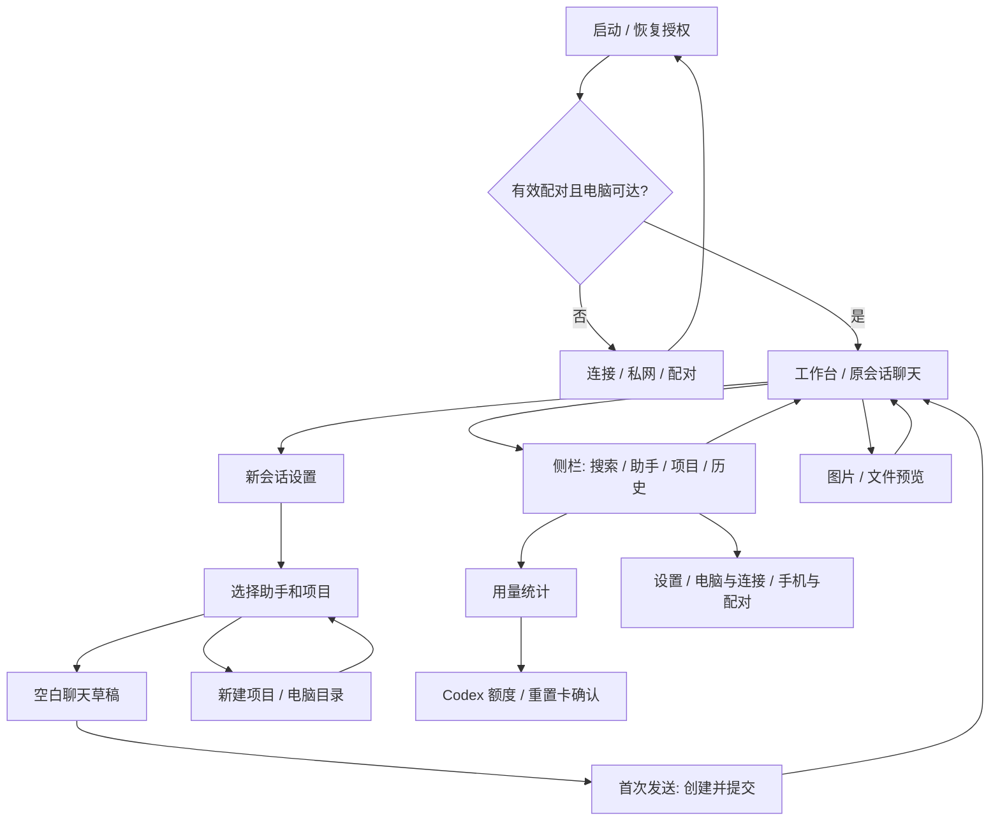

# 当前界面与流程

状态：现有 Flutter 界面的截图、流程与文字线框，供核对现状。历史截图不保证与 0.1.9 完全一致。

需要实际点击体验，请打开 [可交互原型](交互原型/index.html)，操作范围与验证记录见 [原型说明](交互原型/README.md)。原型现直接编译当前 App 的 Flutter 页面组件，仅替换数据与原生能力适配。页面源码一致性经过校验；与手机已安装包的逐页像素核对尚未完成。

## 当前页面 UI

下面直接展示仓库已有的 Flutter 页面截图，方便对照实际界面评审。截图来自历次验收，并非本次重新运行 App 获取；当前客户端为 0.1.9，较早截图中的按钮、文案和布局可能已变化。新会话卡片已有 0.1.5 布局截图；最新用量页及重置卡状态尚缺 Flutter 截图。

### 连接与配对


### 内置网络


### 工作台首页


### 会话聊天


### 新会话：助手与项目选择

0.1.5 验收截图：三个助手同行、项目卡片及底部“开始会话”。


### 工具过程：折叠与展开


### 照片、视频与文件附件

0.1.6 验收截图，三个助手共用附件交互。


### 图片查看


### PDF 阅读


### Word 阅读


### 尚缺当前截图的页面与状态

- 0.1.9 用量统计：三个助手切换、日/月及明细。
- Codex 额度与重置卡确认、结果未知和完成状态。
- 设置、电脑与连接、手机与配对及项目目录选择的完整页面。
- 加载、空数据、连接失败、授权失效、只读和状态未知。

这些页面在后文以流程和文字说明描述，不能把缺少截图视为缺少实现，也不能把历史截图当作当前版本完整视觉基线。下一轮 UI 评审应补齐当前版本截图，再确认需要修改的页面。

## 页面关系



## P01 连接与配对

内容顺序：品牌 → 电脑地址 → 六位配对码或配对链接 → 设备名称 → 连接操作；另提供内置网络入口。恢复已有授权时先等待登录状态，不能瞬间误判为未登录。

失败分支：地址不可达显示连接失败和重试；授权失效进入重新配对；入网成功但未配对继续提示配对。恢复只读探测可以重试，消息发送不自动重试。

历史参考：[配对截图](../../screenshots/flutter/pair-initial.png)、[网络截图](../../screenshots/flutter/network.png)。实现：`flutter_client/lib/main.dart`。

## P02 工作台与原会话

```text
┌──────────────────────────────────┐
│ ☰  当前会话 / 助手             ⋯ │
│ 连接状态                         │
├──────────────────────────────────┤
│ 用户消息 / 附件                   │
│ 工具摘要：状态、命令、可用耗时  ▸ │
│ 助手回复：正文、代码、文件链接     │
│                                  │
├──────────────────────────────────┤
│ 已选附件 / 上传状态               │
│ ＋  输入消息…       发送 / 停止    │
└──────────────────────────────────┘
```

侧栏承担查找与导航：搜索、助手/项目筛选、最近会话、新建会话、用量和设置。点击历史记录进入原会话；归档会话保持只读。

关键状态：首次加载、空会话、回复中、等待审批/回答、断线状态未知、只读、加载失败。工具记录默认折叠，展开显示实际输入输出；切换会话丢弃旧响应。

历史参考：[聊天](../../screenshots/flutter/conversation.png)、[过程折叠](../../screenshots/flutter/hermes-process-compact.png)、[过程展开](../../screenshots/flutter/hermes-process-expanded.png)。实现：`ui.dart`、`process_record.dart`。

## P03 新会话设置

```text
┌──────────────────────────────────┐
│ 新会话设置                     × │
│ 选择助手                         │
│ [ Codex ] [ Hermes ] [Claude Code]│
│ 选择项目                         │
│ [已有项目 A] [已有项目 B]         │
│ [＋ 新建项目]                    │
│                                  │
│          [开始会话]              │
└──────────────────────────────────┘
```

- 选择卡片只更新选中状态；助手和项目均选择后底部按钮才可用。
- 点击“开始会话”进入空白草稿；首条消息发送时才创建真实会话，标题来自首条消息。
- 关闭设置回到原会话；首次创建失败保留可恢复的输入，并按操作编号核对结果。
- 新建项目进入“选择已有文件夹 / 新建文件夹”，目录属于电脑。确认名称后添加项目并返回选择。

当前布局依据：[项目与助手卡片](../../screenshots/flutter/new-session-project-cards.png)。实现：`ui.dart`、`project_picker.dart`。

## P04 附件与文件阅读

附件菜单统一为：添加照片、添加视频、上传文件。选中后显示名称、移除按钮与上传状态；失败可见原因。视频保留原件，模型接收最多 6 帧，不包含音频分析。

点击聊天图片进入可缩放图片页；PDF、DOCX、Markdown、TXT 等进入 App 阅读页，提供返回和原件下载；PDF 有翻页控件。预览过期或文件不可用时提示返回聊天重新打开。

历史参考：[附件菜单](../../screenshots/flutter/claude-media-menu.png)、[图片](../../screenshots/flutter/codex-inapp-image.png)、[PDF](../../screenshots/flutter/codex-inapp-pdf.png)、[Word](../../screenshots/flutter/codex-inapp-word.png)。实现：`resources.dart`、`preview.dart`。

## P05 用量与重置卡

```text
┌──────────────────────────────────┐
│ 用量统计                      刷新│
│ [ Codex ] [ Hermes ] [Claude Code]│
│ 当前助手的额度 / 统计口径说明     │
│ 日 / 月日历与已记录用量           │
│ 项目 / 会话 / 模型明细            │
└──────────────────────────────────┘
```

三个助手入口等宽同行，图标在上、名称在下，选中有边框与底色。切换后展示各自的来源与口径；无数据、加载失败与已知为零必须区分。

Codex 重置卡：读取卡片 → 展示账号、有效期及可用卡 → 用户确认 → 提交 → 刷新真实额度。取消不提交；超时显示结果未知，重试沿用操作编号。只读设备不能消费。

最新页面尚未纳入现有 Flutter 截图集，以上为代码与验证记录整理的线框。下一次界面验收应补截图，不能用早期双助手截图替代。实现：`ui.dart`、`reset_credits.dart`，Web 对应 `web/UsageDashboard.tsx` 和 `web/ResetCredits.tsx`。

## 评审检查项

逐页确认入口、返回位置、主要操作、空/错误/加载状态、只读限制。评审结论写入需求池；需要改变布局的项目先更新本原型，再进入开发。所有截图为历史证据，本次未启动 App 重新截图。
