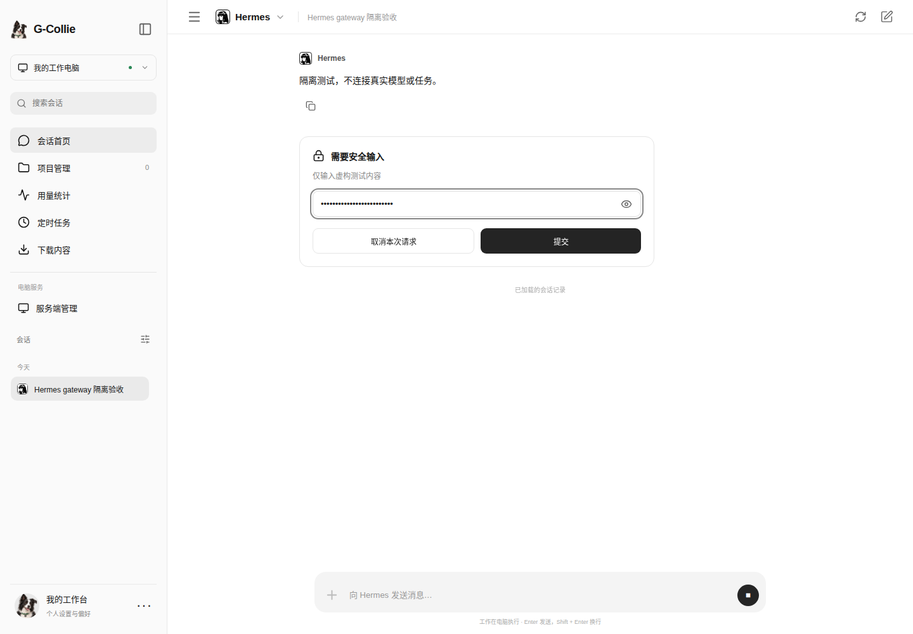

# G-Collie 手机端使用说明

适用版本：电脑服务 **0.3.31**、Android 手机 **0.1.46（48）**。更新日期：2026 年 11 月 17 日。

G-Collie 用手机查看和操作电脑原有 Agent 会话。任务始终在电脑执行：电脑须保持联网、唤醒，运行 G-Collie 及所需 Agent，并完成该 Agent 自己的登录。手机连接成功不表示电脑的全部 Agent 控制能力都可用。

正式手机已验证横屏侧栏滚动访问历史会话、符合条件的 Hermes 删除及同签升级保留配对。

本轮正式手机及两台服务器已完成相关验证，当前 VPN 环境冷启动恢复；具体范围与未测边界见 [验证记录](开发/06-版本发布记录.md)。

## 1. 安装和更新

Android 8 或以上版本，日常安装不需要 ADB。将适合手机架构的 APK 下载到手机，打开后按系统提示允许该来源安装：

```text
g-collie-0.1.46-android-arm64-release.apk
```

大多数实体手机使用 arm64；x86_64 包用于相应设备。只安装确认来源的包。同一包名、同一签名的更新通常保留连接和配对；不要卸载或清数据来处理安装冲突。旧内测 debug 签名与正式签名不同，不能直接覆盖，先阅读 [签名迁移说明](../RELEASE.md#android-签名与升级)。卸载或清数据会丢失手机本地登录和连接，但不会删除电脑会话。

## 2. 先让手机能访问电脑

推荐使用 G-Collie **内置远程连接**：两端无需另装 Tailscale，也无需配置 Serve 或公网端口。电脑和手机仍须分别授权加入同一个有访问权限的 Tailscale 私有网络；需要管理员批准时等待批准。

1. 电脑打开 G-Collie 管理页面，进入侧边栏 **服务端管理 → 网络与服务**。
2. 找到 **内置远程连接**，点击 **启动内置网络 → 生成登录入口 → 在浏览器登录 Tailscale**，完成电脑授权。
3. 等待电脑显示 **已加入私有网络**，复制 **手机连接地址**。
4. 手机首次连接页右上角 **⋮ → 远程连接**；已进入会话后同样从顶部 **⋮ → 远程连接** 打开。
5. 点击 **登录 / 授权入网**，在 App 内官方授权窗口完成登录，返回等待 **已加入私有网络，可以连接电脑**。

详细状态和排错见 [内置远程连接](内置远程连接.md)。如果电脑已使用系统 Tailscale，可沿用已配置的访问入口；不要为了连接 G-Collie 擅自替换原有网络配置。

### 电脑地址怎么填

复制电脑展示的完整地址，包含协议和端口，例如以下占位格式：

```text
http://100.x.x.x:4310
https://电脑名称.网络名称.ts.net:8443
```

以上不能原样使用；以自己的电脑显示为准。内置连接一般使用第一种形式，已有系统 Tailscale HTTPS/Serve 入口可使用第二种形式。内置网络 HTTP 经过私有加密隧道。

手机不要填写 `http://127.0.0.1:4310` 或 `localhost`，它们指手机本身。ADB 无线调试的手机 IP 和调试端口也不是电脑服务地址。局域网 IP 只有在电脑明确启用相应监听且手机可达时才可用，同一 Wi-Fi 不会自动开启该能力。

## 3. 再完成 G-Collie 设备配对

**网络授权与设备配对是两步独立操作。** 显示已入网，只说明网络就绪，还不能访问电脑会话。

1. 在电脑管理页面侧边栏 **服务端管理 → 手机配对与设备**，选择手机可访问的 **手机访问地址**。
2. 点击 **生成配对二维码**，获取六位码或完整配对链接。当前配对固定授予控制设备权限，没有“仅查看”选择；实际能否操作仍由 Agent 与会话状态决定。
3. 手机连接页填写 **电脑地址** 和 **6 位配对码**，点击 **配对并连接**。首次／添加电脑表单使用“地址＋六位码”；完整链接可在网页点击 **在 G-Collie APK 中打开** 自动处理。
4. 成功后进入会话首页；以后启动自动连接上次使用的电脑。

电脑界面个别提示仍称“手机与配对”或“电脑与连接”；当前网页集中管理入口为侧边栏 **服务端管理**，配对在 **手机配对与设备**，内置网络在 **网络与服务**。手机上的 **电脑与连接** 用于选择电脑及查看连接状态。

配对码十分钟有效、一次使用；重新生成会使旧码失效，连续五次错误需重新生成。不要公开配对码、链接或管理密钥。电脑管理密钥只用于电脑本机管理，不填进手机。

APK 与系统浏览器保存的登录互相独立。系统相机扫码通常打开浏览器，不会自动配对 APK；可在网页点击 **在 G-Collie APK 中打开**；若浏览器不能访问内置地址，则在 APK 手填地址与六位码。如果浏览器已消费了短码，给 APK 重新生成一个。

配对凭证有效期九十天；被电脑撤销、主动解除配对或清除 App 数据后需重新配对。

### 怎样确认真的连好了

- 已进入正确电脑的会话首页，能加载会话列表；没有会话时可以正常显示空列表。
- 打开现有会话可读取消息；顶部 **⋮ → 远程连接 → 测试连接** 可检查当前电脑链路，完成时显示 **电脑服务可达 · 测试完成**。
- 需要验证控制时，使用专用测试会话检查发送与返回。仅能读取历史不算 Agent 控制通过；不要在真实任务中随意发送测试内容或停止执行。

## 4. 添加、切换和解除配对

顶部 **⋮ → 切换电脑** 打开电脑列表；也可从工作台菜单 → **电脑与连接** 进入。点击已有电脑恢复其独立凭证；点击 **添加电脑** 填另一台电脑的完整地址及六位配对码。新电脑仍需各自配对。取消添加会回到电脑列表。

电脑列表内 **连接状态** 显示当前服务地址，可 **重新检测连接**。查看实际服务地址，不能把网卡候选地址当成已连通证据。

工作台菜单 → **解除当前电脑配对 → 确认解除配对** 只注销当前手机与该电脑的关系；关闭 App、切换电脑和解除配对均不会停止电脑任务。不再使用的设备也可由电脑管理端撤销。

## 5. 查看和继续会话

首页选择助手可看最近会话，**查看全部会话** 或侧边栏可浏览、搜索和筛选会话与项目。会话来自电脑记录，手机不需要复制项目文件。历史分批加载，当前页不一定是完整历史；更早内容以页面加载能力和电脑原始记录为准。

打开会话，等输入框可用后发送。发送状态会区分发送中、等待记录同步、失败和结果未知；**结果未知时先刷新核对，勿连续重发**。执行中的停止按钮只停止当前轮，不能撤销已经发生的文件修改或命令。

只读或无法输入时，检查归档状态、实时连接、电脑 Agent、Codex 桌面接口及控制开关。无图形桌面或没有相应接口的电脑可能只能读 Codex 历史；已入网、已配对都不能补足这个能力。审批、问题和 Hermes 安全输入按当前卡片处理，未知类型按提示回电脑操作。

新建图标先进入新会话草稿，在 **新会话设置** 选择助手、项目或 **无项目（默认目录）**，点击 **开始会话**。在输入框发送第一条内容后才向电脑创建实际会话，不需要先填写会话名称。是否支持新建取决于电脑后端能力，失败时以错误提示为准。

图片可点开浏览，滑动切换当前会话媒体；退出或切换会暂停视频。工具记录与“已思考”的公开摘要按来源展示，空摘要不提供虚构展开内容。Codex 的目标、计划与插件取决于电脑原生能力；选择技能等内容加入附件后仍需自己点击发送。Hermes 提示词片段仅保存在当前设备。

侧边栏 **用量统计** 保留来源口径；未知不代表零，缓存可能已含在输入中，不能当作完整账户费用账单。会话菜单 **分享会话** 创建当前已加载用户和助手文字的固定快照，不含工具记录；七天有效，可撤销。接收者需能访问电脑地址，分享不会开放公网访问。

### 删除会话

会话标题菜单 → **删除会话**，核对电脑／助手／会话与资格提示，再确认。当前仅新版Hermes原生删除已适配：删除会话及压缩／重置历史，撤销对应分享和提醒，不删除项目文件。Codex和Claude当前安全删除未适配，页面会显示原因。执行中、等待、离线或只读禁止删除；历史详情未知先检查服务端实时资格，服务端仍未知时禁止，不自动停止任务。失败保留；结果未知先刷新核对，不能重复提交。删除成功移除本手机对应同源历史缓存和草稿，返回首页。

### 追加、停止、审批和安全输入怎么操作

| 页面所见 | 操作 | 成功与异常判断 |
| --- | --- | --- |
| 输入框可用、任务空闲 | 输入内容后发送 | 等待电脑记录同步；未知先核对 |
| Hermes／Codex 执行中且支持追加 | 输入补充要求，点击追加 | 在同一会话继续，由来源 Agent 决定如何处理 |
| 正在执行且停止按钮可用 | 点击停止当前轮 | 只请求停止当前轮，不能撤销已完成操作 |
| 需要你的批准 | 核对命令与原因，批准一次或拒绝 | 当前卡片按结果更新；不授权其他任务 |
| 需要你的回答 | 选择或填写所需答案后提交 | 多题均填写；过期时刷新当前请求 |
| 需要安全输入 | 核对来源后在遮罩框提交，或取消本次请求 | 不当作普通聊天发送；结果未知不反复提交 |

Hermes 上游 **managed／安全工作模式** 可能不提供 secret／sudo 请求能力；这与普通模式不同，G-Collie 不会绕过上游限制或伪造一个可用输入框。上面本轮安全输入真机记录针对普通模式专用 QA 会话，不能外推到 managed 模式。

同一电脑上的新版 Hermes 需具备相应 gateway；连接旧服务或不支持的来源时，以页面原因提示为准。当前新版控制已经过浏览器→真实 bridge→隔离 gateway 协议测试；本轮正式 APK／真实来源电脑的验证与未测项见 [当前工作](开发/01-当前工作.md)，不能把下面的浏览器图片视为 Android 真机截图。



### 照片、文件和草稿

在会话输入区点 **＋ → 添加照片／手机文件**，选择内容后检查附件预览，再点击发送。普通附件每条最多五个、单个不超过 10 MB；视频走相应上传／抽帧能力，不能按普通图片能力推断所有视频格式可用。目录引用和提示词片段不是上传整个电脑目录。

图片链路已核对：原 JPEG 的 SHA 与大小一致，本机视觉辅助模型实际接收 1 张图片，再将文字描述交给主模型；不表示主模型直接接收图片像素。

图片上传、模型能否看图、回复中能否预览文件是不同环节；以所选 Agent 与模型的实际支持为准。失败时保留输入并处理错误；切换电脑前核对当前草稿与目标电脑，避免把任务发错位置。不要上传未获授权的账号材料、凭据或私人文件。

### 删除后与失败时

删除确认会展示电脑、助手和会话。删除覆盖该电脑端的原始 Hermes 会话及压缩／重置历史，同时撤销对应 G-Collie 分享与提醒；不可恢复。历史详情显示“未知”不直接等于禁止删除：客户端会重新读取来源服务的删除资格，只有实时资格允许才可确认。来源服务仍判断状态未知／执行中时继续禁止，不会自动停止任务。确定失败后保留会话，先 **重新检查删除条件**；结果未知只刷新核对。Codex／Claude 当前不提供 G-Collie 安全删除，不以归档代替。

## 常用操作逐项指南

本节按当前实现和菜单核对操作路径；不是“本轮所有功能均真机通过”的验收声明。来源能力不可用时以页面原因与错误为准。

<a id="search-projects"></a>
### 搜索、筛选与项目管理

低高度横屏时，侧栏从导航到会话与工作台可以整体上下滚动；普通高度仍保留原布局。若会话暂未露出，先滚动侧栏，不要误认为列表为空。本次修复保持原导航顺序，0.1.46 已在正式手机横屏滚到最早 QA 会话并打开。

1. 首页选择助手查看最近会话；点 **查看全部会话** 或打开侧栏，在搜索框输入会话标题、目录或模型关键词。
2. 在侧栏筛选入口选择助手、项目；清除筛选后恢复完整范围。搜索不跨越已切换的其他电脑，也不代表全文搜索所有消息。
3. 侧栏 **项目管理** → 点击项目查看其会话；项目操作菜单 → **项目详情** 核对所属电脑与工作目录。
4. **新建项目** → **选择已有文件夹** 或 **新建文件夹**：浏览的是来源电脑目录。已有文件夹选好后填写项目名称，点击 **添加项目**；新建文件夹会实际创建电脑目录，核对位置再确认。
5. 项目详情 → **修改显示名称** → 保存，只更改当前手机 G-Collie 中的名称，不改电脑文件夹，也不改官方 Agent 项目名称。不要用重命名项目代替移动目录。

<a id="codex-tools"></a>
### Codex 目标、计划、插件技能与 Sketch

1. 打开能控制的 Codex 会话，输入区 **＋ → 目标、计划与插件**，等待读取电脑原生能力；读取失败点 **重新检查**。
2. 选择 **计划模式／默认模式**；模式在下一轮发送时生效，不改变已经执行中的任务。
3. 在 **持续目标** 填写目标 → **保存目标**；不再需要时点 **清除目标**。目标推进受账号、额度和任务状态约束，不能保证自动完成。
4. 查看电脑已安装插件，点击某项技能的加号，将技能加入当前消息附件，回输入区检查后再发送；不会自动安装插件、授权或运行技能。
5. **＋ → Sketch 草图**，绘制后可 **撤销笔画／清空**，再点 **加入会话附件**；回到输入区后仍需自己发送。草图按图片处理，不等于执行绘图中的指令。

这些入口依赖 Codex 原生桌面能力；服务器只有 CLI、接口缺失或只读时不能靠重新配对使其可用。不要用清除目标来停止当前轮。

<a id="schedules"></a>
### 定时任务：创建、暂停、编辑与取消

当前定时发送支持 **Codex**，由当前来源电脑执行；不要把页面存在理解为 Hermes／Claude 定时能力已实现。

1. 侧栏 **定时任务** → 右上角 **＋**，选择发送时间、重复方式（仅一次／每天／每 5 小时）并填写消息。
2. **发送到** 可选已有 Codex 会话或默认的新建会话；核对时间显示的当前设备时区和目标电脑，点 **保存定时任务**。
3. 列表中关闭开关暂停，打开开关恢复；点 **编辑** 调整时间、目标或内容后保存。
4. 点 **取消任务 → 确认取消**，停止后续按此计划发送；这不会撤销已发送消息或已执行工作，也不等于停止当前 Agent 轮次。
5. 列表加载失败点 **重试**。任务显示 **发送失败／结果未知** 时先检查目标会话，不重新建一个相同任务来“补发”。

电脑须在线并运行服务；手机可以离线。错过时间不自动补发。任务归属、来源权限与状态限制仍生效，切换电脑前核对计划所在电脑；不承诺所有电脑之间同步计划。

<a id="downloads-media"></a>
### 媒体预览与下载：筛选、打开和失败重试

1. 会话内点图片或媒体查看入口进行预览；图片按来源比例展示，可切换当前会话媒体。视频点播放，退出或切换后会暂停；无法加载时先检查网络与来源文件。
2. 文档或会话文件入口可打开支持的预览；未知格式可能需要下载后交给系统应用，不能保证每种格式都有内置预览。
3. 下载后从侧栏 **下载内容** 查看记录，切换 **全部／下载中／已完成／失败**。这是手机本地下载记录，不与电脑网页下载列表同步。
4. 完成项点 **打开**；图片可在 App 预览，其他文件交给系统支持的应用。没有可处理该格式的应用时，安装合适的查看器或在电脑打开。
5. 失败项显示 **重试** 时，先切到记录所属电脑并恢复连接再重试；无可恢复信息时按提示回原会话重新下载。列表本身加载失败时用页面 **重试**。

来源文件已移走、下载授权过期或电脑不可达，都可能使重试失败。保存文件不代表已验证它安全，打开前核对来源。

<a id="sharing"></a>
### 分享、撤销和会话维护

1. 会话标题菜单 → **分享会话** → 核对预览 → **创建只读快照**，再 **复制链接**。
2. 快照是创建时已加载的用户／助手文字，不自动跟随后续新消息，不含工具记录；默认七天有效。接收者也须能访问来源电脑服务，链接不会替你开放公网。
3. 回到同一会话 **分享会话** → **撤销分享**，使该 G-Collie 分享失效；对方已经复制或保存的内容无法收回。Codex 原生分享以对应页面提示为准，不把它当成可在此撤销的 G-Collie 快照。
4. 会话标题菜单可 **复制会话 ID／会话信息**，用于可信渠道反馈。Hermes 支持时可重命名或 **归档会话**；归档是隐藏，不等于永久删除，需要恢复时回来源电脑。
5. 删除见上面的 **删除会话**；切换电脑不会移动或合并会话。清手机缓存、解除配对、关闭 App 都不等于删除电脑记录。

<a id="usage-maintenance"></a>
### 用量、额度、诊断与维护

- 侧栏 **用量统计** 选择助手、账号／本机口径及日期查看。**未知** 不等于零，也不是完整账单。额度查询失败先重试或检查 Agent 登录。
- 有可用重置卡时，先核对范围、到期时间与剩余次数再确认 **重置额度**；这会消费对应次数，日常排错不需要先重置额度。
- 顶部 **⋮ → 故障诊断** 检查连接和近期失败；反馈前脱敏，不分享管理密钥、凭据或完整私人会话。导出能力以实际页面与来源服务为准。
- 更新、清缓存、通知与解除配对按本手册相应章节操作；避免为解决网络问题清数据、卸载或重置私网身份。

## 6. 通知、外观与缓存

顶部 **⋮ → 任务提醒 → 开启提醒**，允许 Android 通知权限；工作台菜单 **通知** 也可管理提醒；其中“发送测试通知”走浏览器推送通道，不能据此验证 APK 原生任务提醒。启用后显示后台同步常驻通知，任务结束、需要处理或持续断线时可提醒，不显示聊天正文。可在相同菜单或常驻通知停止提醒。

关注最近打开的最多三十个会话，电脑服务重启后恢复关注列表；首次加载、服务重启和断线期间不推断任务完成。手机强制停止、省电策略和 Android 后台时长限制可能中断同步，不能保证全天候提醒。达到限制后需打开 App 重新开启。测试通知到达不等于长时间锁屏场景已验证。

浏览器通知另需支持 Web Push 的 HTTPS 环境并单独授权，APK 的内置网络不让其他浏览器自动获得网络访问能力。

工作台 **外观** 可调整主题和字体。顶部 **⋮ → 本地缓存** 可清理当前电脑缓存，不删除电脑会话、草稿或下载文件；缓存不能替代在线连接，也不代表完整离线历史。

## 7. 常见问题

| 现象 | 检查和处理 |
| --- | --- |
| 安装冲突 | 核对包名与签名；同签覆盖更新，换签先读迁移说明，勿直接清数据 |
| 远程连接一直等待批准 | 请网络管理员批准手机或电脑节点，App 不会绕过审批 |
| 已入网但连接失败 | 核对完整地址及端口、服务运行和电脑休眠、网络访问策略；分别检查网络授权与设备配对 |
| 已入网或测试成功，目标新电脑仍连不上 | 已入网只说明网络节点状态。先核对顶部当前电脑，再到切换电脑 → 连接状态核对地址，重新测试该目标；切换失败时可能仍停在旧电脑，旧机测试结果不能证明新机可达。先核对，不清数据、退出网络或反复配对 |
| 地址能打开但不是 G-Collie | 很可能使用了其他服务的端口，重新复制电脑服务地址 |
| 浏览器能用、APK 仍要码 | 两者凭证独立，为 APK 重新生成配对码 |
| 配对失效 | 在电脑管理端重新生成码；检查是否过期或被撤销 |
| 只能看历史 | 检查 Agent 实时接口、归档和控制状态，不要重复配对来替代后端连接 |
| 切网后暂时断线 | 等待恢复，必要时顶部菜单重新连接并运行测试；不要重复发送结果未知的消息 |
| 提醒未到达 | 检查系统通知许可、后台同步、省电限制、网络和关注范围 |

本页按当前源码和菜单整理，不能视为所有手机、外网、账号及长后台场景均已实测。具体版本和设备证据见 [当前工作](开发/01-当前工作.md)，能力限制见 [能力矩阵](能力矩阵.md)。电脑安装见 [电脑端使用说明](电脑端使用说明.md)。
