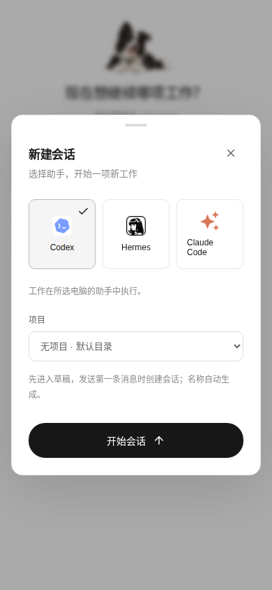
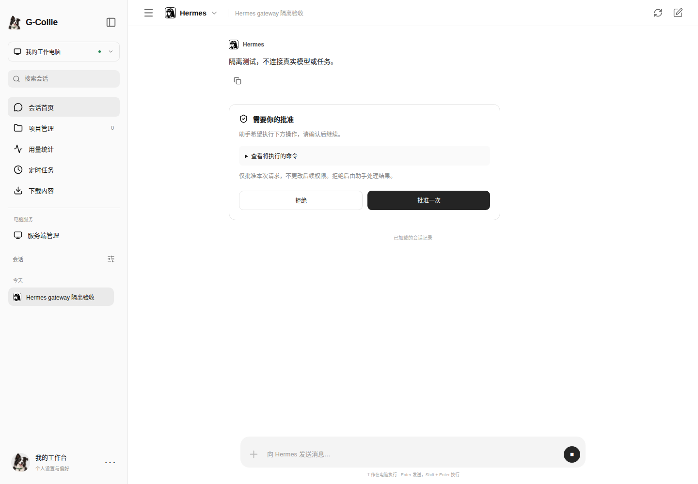

# G-Collie 电脑端使用说明

本手册以公开版电脑服务／网页 **0.3.35** 和 Android **0.1.51** 为基线。另行标注的源码改动尚未发布。[下载安装包](https://github.com/GiggleRobotics/G-Collie/releases/tag/v0.3.35) · [版本变化](更新日志.md)

任务在安装了 Agent 的电脑执行，手机查看和操作这台电脑的原会话。首次使用可先按 [首次连接指南](https://gigglerobotics.github.io/G-Collie/start/) 操作，本页补充安装、管理、服务器及故障处理。

## 使用前准备

- 当前 DEB 面向 Linux amd64（x86_64）。Windows、macOS、Linux ARM64 暂无已验证的安装包。
- 桌面安装需要 Python 3、systemd 用户会话、xdg-utils；Node.js 与内置网络程序随 DEB 提供，依赖由 apt 处理。
- 需要哪个 Agent，就先在同一电脑、运行 G-Collie 的同一用户下安装、登录并确认其可用。
- 电脑保持联网和唤醒。关闭浏览器不影响后台服务；关机、休眠或用户服务退出会影响连接。

Codex 有桌面与终端两种控制后端。服务启动时有桌面接口则保留原桥；无桌面服务器连接本用户的 Codex app-server，优先复用安全的现存 daemon，否则启动服务专用 stdio 后端。CLI 仍需正常登录／模型配置；打开历史会话后由原有恢复入口连接，不会因列表读取自动恢复。Hermes、Claude Code 也需各自后端可用。

### Agent 安装与登录分别检查

在来源电脑的服务用户下安装需要的 Agent，并按各自官方说明完成登录。Claude Code 安装见 [官方安装说明](https://code.claude.com/docs/en/setup)；安装 CLI 不等于已登录或已能执行任务。无头服务器同样需要在该用户终端完成相应授权／配置，不能从另一台电脑的登录状态推断可用。

Claude Code 的外部终端会话可查看历史。要通过 G-Collie 发送和停止，请先确认 CLI 可以执行任务，再从 G-Collie 新建会话。各助手的来源与控制条件见[能力矩阵](能力矩阵.md)。

## 安装并打开电脑管理端

从 [v0.3.35 发行页](https://github.com/GiggleRobotics/G-Collie/releases/tag/v0.3.35)下载 Linux amd64 DEB 及同名 `.sha256` 文件，在下载目录执行：

```bash
sha256sum -c g-collie_0.3.35_amd64.deb.sha256
sudo apt install ./g-collie_0.3.35_amd64.deb
g-collie
```

最后一条用日常运行 Agent 的桌面用户执行，不加 sudo。也可从应用菜单启动 G-Collie。

启动器会配置当前用户服务，打开 `http://127.0.0.1:4310/` 并完成本机管理登录。若手动打开网页出现配对页，重新执行 `g-collie`；手动首次设置可在本机登录页点击 **电脑首次设置**，读取本用户数据目录的 `access-token`，填入 **管理密钥** 后点击 **连接管理端**，仅在本机使用。手机只需要一次性配对码，不需要此密钥。

运行 `g-collie status` 检查服务。标准桌面安装是**用户登录后**自动启动，不自动保证注销后或系统重启未登录时仍运行。

## 推荐连接：两端内置私网

电脑和手机都内置 Tailscale 网络组件，无需另装 Tailscale App、设置 VPN 或开放公网端口。

1. 电脑网页侧栏打开 **服务端管理 → 网络与服务**。
2. 在“内置远程连接”点击 **启动内置网络 → 生成登录入口 → 在浏览器登录 Tailscale**。
3. 登录自己的 Tailscale 账号并授权电脑；等待必要的网络管理员批准。
4. 返回页面，确认 **已加入私有网络**，复制 **手机连接地址**（形如 `http://100.x.x.x:4310`，以实际显示为准）。
5. 进入 **服务端管理 → 手机配对与设备**，在 **手机访问地址** 选择该内置地址，点击 **生成配对二维码**。
6. 手机安装当前 APK，从 **远程连接** 登录同一个有访问权限的网络，等待“已加入私有网络，可以连接电脑”。
7. 在手机 **连接电脑** 输入完整地址和六位配对码；也可在地址或配对码输入栏粘贴完整链接，确认信息后提交；网页上的 **在 G-Collie APK 中打开** 可将链接交给 App。已进入首页时，从顶部电脑名称或 **⋮ → 切换电脑 → 添加电脑** 进入。
8. 手机顶部应显示正确电脑名称和绿色状态；在 **切换电脑 → 连接状态** 检查地址和 **服务：正常**，再打开已有会话验证历史。

配对码10分钟有效、一次使用，新码替换旧码，连续五次错误作废。当前新配对授予控制设备权限，没有“选择只读”的步骤；电脑管理端才能管理其他设备。设备凭证当前90天有效，正常重启／同签覆盖升级无需重新配对。

二维码通常先由系统相机交给浏览器；浏览器和 APK 的配对独立。网页可点击 **在 G-Collie APK 中打开**；如果浏览器不能访问内置地址，则在 App 手填完整地址与六位码。手机内置私网仅为 G-Collie 提供连接，其他浏览器不自动获得私网访问能力。

更多步骤、恢复与权限说明见 [内置远程连接](内置远程连接.md)。

## 其他已有网络方式

| 方式 | 使用条件 |
| --- | --- |
| 系统 Tailscale／HTTPS Serve | 使用已配置的完整 HTTPS 地址及端口；保留原 Serve 服务。手机要有对应网络访问能力，仍需 G-Collie 配对 |
| 局域网 | 默认仅回环监听，同 Wi-Fi 不能保证可达；管理员先配置可信网段监听与访问权限，再填写实际局域网地址及4310端口 |
| ADB 调试 | 开发人员设置反向转发后，手机才可使用127.0.0.1；依赖ADB连接，不作为日常远程方案 |

内置私网用户按推荐流程即可，无需同时配置其他方式。不要将服务直接暴露到公网，也不要把 SSH 端口或另一网页服务端口填到手机。

## 服务器部署与限制

在云服务器安装，只会读取该服务器对应用户的 Agent 数据，不会同步个人电脑上的会话。没有图形桌面时，Codex 原桌面控制接口可能不可用；先确认所需 Agent 的服务器运行方式，不把“服务正常”当作“所有 Agent 可操作”。

### 只有终端，网页要配对，码在哪里找？

在**服务器 SSH 终端、运行服务的同一用户**下生成一次性码，无需先登录远程网页：

```bash
g-collie pair
```

命令显示访问地址、六位配对码、短期链接和到期时间。远程浏览器在“配对你的电脑”页面填设备名称与六位码，即可访问；手机同样填写地址与六位码，但**浏览器和手机各要一个新码**。10分钟内一次有效，生成新码使旧码失效。不要向手机或远程网页输入 `access-token` 管理密钥。

如使用非默认端口或需要明确指定本机监听地址：

```text
g-collie pair http://服务器自己的私网IP:4310
```

此参数只接受服务器本机网卡或回环HTTP地址，不支持用该命令管理另一台远端主机。自定义数据目录时先设置与服务相同的 `GCOLLIE_DATA_DIR`。

公开版 0.3.35 包含 `g-collie pair`。原始 0.3.27 DEB 尚无该命令；仍使用旧安装时，可先升级或通过下面的 SSH 转发进入管理页。

### 旧安装或首次配置内置网络

有可用 systemd 用户会话的服务器，可以在实际 Agent 用户下执行 `g-collie install-service`，不自动打开浏览器。管理员可建立 SSH 本地转发，再从自己的电脑浏览器进入服务器的本机管理网页：

```bash
ssh -N -L 14310:127.0.0.1:4310 your-user@your-server
```

将用户名和服务器地址换成自己的值；保持该终端连接，打开 `http://127.0.0.1:14310/`。点击 **电脑首次设置**，在 **管理密钥** 填入**服务器相同服务用户**数据目录中的管理密钥，点击 **连接管理端**，然后按上面的网络授权与设备配对步骤操作。这个 SSH 转发只用于管理员配置，不是手机的日常连接地址。完成后关闭转发，手机继续使用已授权的私网入口。

若服务器没有 systemd 用户会话，或需要无人登录时启动，应由管理员配置独立系统服务，以实际 Agent 用户运行，并设置该用户的 HOME、PATH 和私有数据目录。不要直接套用桌面用户服务命令，也不要默认切成 root 读取另一用户的数据。系统级服务使用 `sudo systemctl status g-collie` 等系统管理命令，桌面版 `g-collie status` 查询的是用户服务，两者不同。

Ubuntu 24.04 云主机曾完成系统级安装、启用自启和手机私网接入，未实测主机重启后的自启。0.3.32 起无图形桌面也支持原生 Codex 终端控制。[分版本验证记录](开发/06-版本发布记录.md)

### Codex 终端控制配置

通常无需手动配置：启动时存在桌面 IPC 则使用桌面桥，否则使用原生终端后端。选择在本次服务运行期间保持不变，桌面断线不会偷偷切换执行端。

需要明确指定时，在运行服务的 systemd unit 环境中设置 `ORBIT_CODEX_BACKEND=app-server` 或 `desktop`，重启 **G-Collie 服务** 生效；`auto` 为默认。终端后端默认允许控制，显式 `ORBIT_DESKTOP_CONTROL=0` 或已有关闭设置仍优先；`ORBIT_CODEX_BIN`／`CODEX_CLI_PATH` 可指定同用户 CLI。

新建仍是选助手／项目后首发创建。打开历史会话会用原有连接流程恢复；后台读取只查询历史，不执行 `thread/resume`。已有安全 daemon 可共享原生状态；独立后端发现其他 Codex 终端／桌面进程时拒绝接管，需先在原终端确认结束该会话。不要随意结束其他真实任务。控制超时／结果未知先核对，不换操作编号重复发送。

审批仅提交原生提供的本次决定；上游的 `cancel` 在现有界面中表现为“拒绝”。终端后端暂不提供未经协议验证的计划模式，Codex 安全删除仍未适配。

## 日常会话与设备管理

- 选择首页 Agent 只筛选会话，不自动创建任务。新建时选助手和项目，进入草稿，首次发送才创建会话。
- 会话执行中，支持追加时可输入并发送；输入为空时显示停止。未知／离线／启动中等状态按页面提示限制操作，超时后先核对结果，不连续重发。
- 新打开会话定位最新；主动上滚阅读时保留位置，可用跳底按钮回到最新。历史支持分页加载，来源缺失的记录仍需到 Agent 原程序核对。
- 审批和问答只支持已适配类型；提示去电脑处理时，在相应 Agent／宿主应用处理。
- **服务端管理 → 手机配对与设备** 查看和撤销设备。撤销会使对应凭证失效；切换电脑或注销手机不会停止电脑任务。
- 分享是创建时的只读快照，持有链接且能访问服务的人可阅读；分享链接不会创建公网访问权限，分享前检查私人内容。
- 手机原生通知从 **⋮ → 任务提醒** 开启，并允许系统通知。浏览器/PWA通知有独立的权限、HTTPS和网络要求，详见手机手册。长后台不保证持续在线。

## 网页操作图解

远程浏览器与电脑本机打开的是同一服务。远程浏览器先配对，随后按电脑 Agent 的实际接口操作原会话；不要求浏览器运行在服务器上。无桌面服务器由 app-server 提供控制；独立 stdio 后端无法确认其他终端是否持有原会话时保守拒绝恢复，不另开分叉执行。

### 新建、发送、追加与停止

1. 首页选择要用的助手，然后点击“最近会话”旁 **新建会话**；顶部原快捷入口也保留。
2. 选择助手与项目（或 **无项目 · 默认目录**），点击 **开始会话**。不填写名称，也不在此页面填写首条消息。
3. 此时是尚未创建的草稿；在输入框写任务、添加所需附件后点击发送，首条发送时才创建实际会话。
4. 打开已有会话后继续发送。Hermes／Codex 的执行中追加以当前页面可用按钮为准；**停止当前轮** 会请求停止当前执行，不撤销已完成的文件修改。
5. 如果显示发送失败或结果未知，先刷新列表与来源 Agent 核对。不要连续重发，也不要用停止代替核对。

**当前源码（未发布）** 在输入框上方显示首条消息状态。看到“正在确认发送结果”时，正文和附件留在原草稿，点击会话刷新即可查询。看到“首条消息未发送”时可继续编辑；电脑明确指出某张图片无法读取时，先移除或更换该图，再点击发送。窄屏下，从项目、用量、定时、下载、诊断和服务端管理页面的标题左侧可打开会话列表。



*正式网页浏览器截图，使用隔离数据；并非手机 App 截图。*

### Hermes 审批、问答与安全输入

- **需要你的批准**：先展开查看操作，再选 **批准一次** 或 **拒绝**。仅处理当前请求；来源没有提供的选项不可用。
- **需要你的回答**：选择或填写卡片中要求的答案，多题逐项填写后提交。请求过期或轮次变化时，重新读取当前卡片。
- **需要安全输入**：输入框默认遮罩；只在确认来源与用途后提交。点击 **取消本次请求** 表示取消，不会向会话发送一条普通消息。取消／提交的结果以卡片消失或来源确认状态为准，未知时不要重复提交。
- 普通 Hermes 模式已完成正式手机专用 QA 的安全输入／sudo 取消与虚构值遮罩提交；上游 managed／安全工作模式未提供 secret／sudo 能力时不可用，不模拟绕过，也不把普通模式验收外推到 managed 模式。
- 新版 Hermes 的请求绑定会话轮次；G-Collie 不会把旧轮次的批准自动应用到新任务。不支持的请求类型仍回电脑处理。



*真实 bridge 与 gateway 协议的隔离测试，无命令执行、无模型调用，不是生产会话的批准记录。*

### 图片与文件

输入区 **＋ → 添加照片／上传文件**，确认附件预览后再发送。每条消息最多五个附件，单个普通附件不超过 10 MB；图片按 Agent 支持情况处理，文档等作为文件上下文引用。支持的资源可从会话文件入口预览、筛选和下载。文件仍由来源电脑保存，不代表手机自动复制整个项目。

图片传输成功只说明附件交给后端，不保证当前模型具备视觉能力；以该 Agent 的配置和实际返回为准。上传中或失败时先处理附件状态，勿重复点击发送。

## 删除会话

会话标题菜单选择 **删除会话**，查看当前电脑、助手、会话及检查结果后确认。当前只支持新版Hermes原生删除，包含该会话的压缩／重置历史，并撤销对应分享和提醒，不删除项目文件。Codex与Claude目前安全删除未适配，入口说明原因，不会改成归档或直接删除数据文件。执行中、等待、离线和只读时禁删；历史详情的“未知”状态先读取服务端实时资格，服务端仍判断未知时禁止，明确允许才可确认；确定失败保留，必须 **重新检查删除条件** 后才能再次确认；返回结果不完整同样按未知处理，结果未知仅刷新核对，勿重发。

## 网页其他操作与手机的区别

<a id="web-search-projects"></a>
### 搜索、项目与 Codex 能力

- 侧栏搜索框输入标题、目录或模型关键词；筛选按钮选择助手与项目，清除筛选恢复范围。点击 **项目管理** 中的项目会回到对应项目的会话列表。
- **项目管理 → 添加项目**，填写来源电脑已有目录和显示名称后保存；网页版此操作关联已有目录，不创建或删除电脑文件夹。手机的“新建文件夹”和本地显示名称管理是独立入口，见 [手机项目步骤](手机端使用说明.md#search-projects)。
- 可控 Codex 会话输入区 **＋ → 目标、计划与插件**：选计划／默认模式，填写并保存／清除持续目标；技能加到附件后自己发送。**＋ → Sketch 草图** 绘图后加入附件再发送；这些能力依赖来源电脑接口，不自动安装插件或授权。详细边界见 [Codex 操作](手机端使用说明.md#codex-tools)。

<a id="web-schedules"></a>
### 定时任务

侧栏 **定时任务 → ＋**，选择新建或已有 Codex 目标会话、发送时间、单次／每天／每 5 小时和消息，点 **保存任务**。列表中 **暂停／启用** 控制后续计划，**编辑** 修改参数，**取消任务** 终止后续发送。电脑保持运行，错过时间不补发，手机不必在线；当前仅支持 Codex。网页显示当前浏览器设备归属的计划，不能据此认定手机或其他浏览器的计划自动同步。加载失败用页面重试，执行结果未知先检查会话，勿建立重复计划。

<a id="web-downloads"></a>
### 文件、预览与下载

会话中点图片／文件打开支持的预览；未知格式可下载后在系统应用查看。侧栏 **下载内容** 先选择 **来源会话**，再按 **全部／图片／文件** 筛选并点 **下载**；来源读取失败点 **重试**。浏览器负责保存文件和进度，完成后在浏览器下载记录中打开；这不是手机 **下载中／已完成／失败** 状态列表，也不会同步手机本地文件。来源电脑需可达，文件已移走时重新读取也不保证可恢复。

<a id="web-share-maintenance"></a>
### 分享、撤销与诊断

会话标题菜单 → **分享会话**，核对当前已加载文字后 **创建分享链接／创建只读快照**，复制后交给能访问电脑服务的人。G-Collie 快照不会跟随后续消息，默认七天有效；同一弹层的 **撤销此分享／撤销分享** 使该分享失效，对方已另存的内容无法收回。Codex 原生分享按页面边界处理，不冒充可撤销的 G-Collie 快照。

标题菜单还可复制会话 ID／目录、查看信息；来源支持时才有重命名或归档。归档不等于删除。侧栏 **用量统计** 核对统计口径，未知不当零；额度重置会消费卡片次数，操作前核对范围。**服务端管理／更多操作 → 故障诊断** 可查看连接问题，设备管理中的撤销只撤销该设备权限，不停止来源任务。后台服务维护与备份见下一节。

## 服务、数据、备份与更新

标准桌面用户服务命令：

```bash
g-collie status
g-collie doctor
journalctl --user -u g-collie -n 50 --no-pager
```

需要维护时使用 `g-collie start`、`stop` 或 `restart`。操作前避开正在进行的重要控制请求。原始 Agent 任务不等于 G-Collie 服务进程。

安装版默认数据 `~/.local/share/g-collie`，自定义 XDG_DATA_HOME 或 GCOLLIE_DATA_DIR 时以配置为准；源码默认是项目 `.data/`。配对、设置、分享、私网身份等属于私有信息，原始会话仍在 Agent 自己的数据目录。

升级前执行 `g-collie backup`。它会短暂停止并恢复用户服务，备份保存在 `~/.local/share/g-collie-backups`，含私有凭证，勿上传为普通反馈。系统级部署由管理员备份实际数据和unit，不能用用户服务备份命令代替。

再安装新版 DEB并重启相应服务，检查实际版本。没有自动在线升级。Android同签覆盖更新可保留数据；旧debug内测和正式签名的迁移见 [发行说明](../RELEASE.md#android-签名与升级)。

标准桌面卸载先运行 `g-collie uninstall-service`，再 `sudo apt remove g-collie`，个人数据保留。系统级部署还需管理员停用自己配置的unit。不要为解决连接问题直接删数据、卸载手机或重置网络身份。

## 按症状排查

| 现象 | 检查与处理 |
| --- | --- |
| 电脑网页打不开 | 服务状态、4310端口冲突和日志；确认在正确服务用户下操作 |
| 手机连不上 | 两端入网状态及访问策略、完整地址/端口、电脑未休眠；默认127监听不能直接用局域网IP替代 |
| 入网成功仍需配对 | 正常：网络访问和G-Collie设备授权是两层权限 |
| 配对码错误/过期 | 在电脑重新生成，别用已使用或旧码；不要把管理密钥填到手机 |
| 手机只看到另一台电脑会话 | 检查顶部主机名称；从切换电脑选择目标；云端和本地不会自动同步 |
| 连接正常但不能发送 | 查看会话归档、未知状态、待处理请求和Agent控制接口；无桌面时检查原生 app-server、CLI 登录及是否存在其他终端占用 |
| 发送超时、结果未知 | 先刷新、核对Agent原程序，不自动重发，也不要先停任务 |
| 通知没到 | 通知权限、后台限制、服务和网络；未收到通知不代表任务没完成 |

反馈提供两端实际版本、系统、Agent类型、操作步骤和脱敏截图。不要附管理密钥、设备凭证或完整私人会话。

## 当前验证范围

公开版分别记录了 Linux 各系统的提取运行或安装、Codex 终端控制、Hermes 轮次控制与删除，以及手机的同签覆盖和连接恢复。后台通知、长期锁屏、所有网络组合和主机重启仍需按具体环境验证。[发行说明](../RELEASE.md) · [历史验证记录](开发/06-版本发布记录.md)
